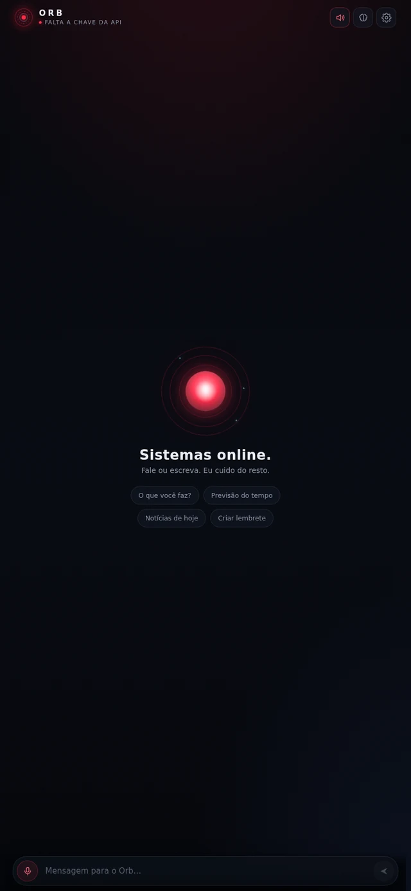

# Orb — Assistente Pessoal de IA para o seu bolso

Um assistente de voz e texto que roda no seu servidor e abre como aplicativo no
celular. Conversa, pesquisa na web, consulta o clima, lembra de fatos sobre você
e dispara lembretes — com uma interface HUD feita para a tela pequena.

Inspirado no **JARVIS (Mark LVII)**, de FatihMakes: a ideia da escada de
modelos do Gemini, a filosofia de memória e o tom do personagem vieram dele. No
lugar da camada desktop (PyQt, controle do computador), este projeto tem uma API
e um app móvel instalável — código escrito de forma independente.

<p align="center">
  
</p>


> **Licença:** **Licença Orb 1.0** — © 2026 Yanikuaite. Você pode usar,
> modificar e distribuir este projeto, inclusive comercialmente, desde que
> mantenha o crédito. Leia `LICENSE`. A inspiração no JARVIS está creditada em
> `NOTICE`, e o projeto original continua sob CC BY-NC 4.0.

---

## Como funciona

```
┌─────────────────────────┐         HTTPS / WSS        ┌──────────────────────────┐
│  Celular (PWA/Capacitor)│  ───────────────────────▶  │  Servidor Python         │
│  • HUD e chat           │                            │  • FastAPI               │
│  • microfone → WAV      │  ◀───────────────────────  │  • Agente + ferramentas  │
│  • voz (TTS)            │        JSON + áudio        │  • Memória e lembretes   │
└─────────────────────────┘                            │  • Gemini (texto/voz)    │
                                                       └──────────────────────────┘
```

O celular é a boca e os olhos; o servidor é o cérebro. Isso é proposital: a
chave da API nunca vai para o telefone, a memória fica em um só lugar e o mesmo
app pode ser aberto em vários aparelhos.

## O que ele faz

- **Conversa por voz ou texto**, com respostas curtas pensadas para serem ouvidas.
- **Memória de longo prazo** com painel para ver e apagar cada fato.
- **Pesquisa na web** com fontes (Gemini grounding, com fallback DuckDuckGo).
- **Clima** de qualquer cidade, via Open-Meteo (sem chave extra).
- **Lembretes** com notificação no celular enquanto o app estiver aberto.
- **Voz do aparelho** (grátis) ou **voz Gemini** (mais natural).
- **Instalável** como PWA no Android/iOS, ou empacotável como APK/IPA.

## Começando (5 minutos)

### 1. Requisitos

- Python 3.11+
- Uma chave do Google AI Studio: <https://aistudio.google.com/apikey>

### 2. Instalar e rodar

```bash
python -m venv .venv
source .venv/bin/activate          # Windows: .venv\Scripts\activate
pip install -r server/requirements.txt

cp .env.example .env
# edite .env e cole sua chave em ORB_API_KEY

python -m server
```

Abra <http://localhost:8000>. Sem chave configurada o app abre em modo de
configuração; cole a chave em **⚙ Ajustes → Chave da API Gemini** ou deixe no
`.env` e reinicie.

### 3. Abrir no celular

O microfone do navegador exige **HTTPS** (ou `localhost`). Na mesma rede, o
caminho mais rápido é um túnel HTTPS:

```bash
# opção A — Cloudflare Tunnel (gratuito, HTTPS automático)
cloudflared tunnel --url http://localhost:8000

# opção B — Tailscale (rede privada, HTTPS)
tailscale serve https / http://localhost:8000
```

Abra a URL HTTPS no celular e use **Compartilhar → Adicionar à tela de início**
(iOS) ou **Instalar aplicativo** (Android/Chrome). O app abre em tela cheia.

> Sem HTTPS, o chat por texto funciona, mas o microfone fica bloqueado pelo
> navegador. Para uso só em rede local confiável, `http://IP:8000` serve para
> texto.

## Deploy com Docker

```bash
cp .env.example .env    # preencha ORB_API_KEY e ORB_TOKEN
docker compose up -d --build
```

Coloque um proxy HTTPS na frente (Caddy é o mais simples):

```caddyfile
orb.seudominio.com {
    reverse_proxy 127.0.0.1:8000
}
```

### Proteção por token

Defina `ORB_TOKEN` com uma string longa e aleatória. Quando ele existe:

- a API responde `401` sem `Authorization: Bearer <token>`;
- o app pede o token uma vez em **⚙ Ajustes → Token de acesso**.

Isso é essencial se o servidor estiver exposto na internet.

## Aplicativo nativo (APK / IPA)

O `mobile/www` é um app web completo. O [Capacitor](https://capacitorjs.com/)
empacota esse mesmo código como app nativo.

```bash
cd mobile
npm install

# Android (precisa do Android Studio + SDK)
npx cap add android
npx cap sync
npx cap open android      # rode no emulador ou gere o APK

# iOS (precisa de macOS + Xcode)
npx cap add ios
npx cap sync
npx cap open ios
```

Há dois modos:

1. **Casca nativa apontando para o servidor** — o jeito mais simples de manter
   atualizado. Em `mobile/capacitor.config.json`, adicione:
   ```json
   "server": { "url": "https://orb.seudominio.com" }
   ```
   O app nativo carrega a versão publicada no servidor.

2. **App embarcado** — sem `server.url`, os arquivos vão dentro do APK. Nesse
   caso, informe o endereço do servidor em **⚙ Ajustes → Endereço do servidor**
   na primeira execução.

## Ferramentas disponíveis

| Ferramenta | O que faz |
|---|---|
| `web_search` | Pesquisa, notícias e pesquisa profunda com fontes |
| `get_weather` | Clima atual e previsão de 1 a 7 dias |
| `remember` / `forget` / `recall` | Memória de longo prazo |
| `now` | Data e hora do servidor |
| `set_reminder` / `list_reminders` / `cancel_reminder` | Lembretes com push no app |

Ferramentas de desktop do JARVIS (abrir programas, controlar o mouse, capturar a
tela) **não** existem aqui: um celular não pode executá-las, e uma ferramenta que
promete o impossível é pior do que nenhuma.

## Configuração

`server/config.json` (criado na primeira alteração) aceita:

```json
{
  "assistant_name": "Orb",
  "user_name": "",
  "language": "pt-BR",
  "voice": "Charon",
  "tts_engine": "browser",
  "persona": "",
  "model_ladder": ["gemini-3.5-flash-lite", "gemini-flash-lite-latest", "gemini-2.5-flash"],
  "smart_ladder": ["gemini-3.5-flash", "gemini-flash-latest", "gemini-2.5-flash"],
  "tts_model": "gemini-2.5-flash-preview-tts"
}
```

- `tts_engine`: `browser` usa a voz do sistema (grátis e instantânea);
  `gemini` usa o TTS do Gemini (mais natural, consome cota).
- `model_ladder`: ordem de modelos tentados. Um modelo sem cota é posto de
  descanso por 5 minutos e o próximo assume — a conversa não cai.
- `persona`: instruções extras de personalidade.

Variáveis de ambiente têm prioridade para a chave: `ORB_API_KEY`,
`GEMINI_API_KEY` ou `GOOGLE_API_KEY`.

## Estrutura do projeto

```
server/
  main.py              # FastAPI: rotas, WebSocket, arquivos estáticos
  orb/
    settings.py        # configuração e chave
    llm.py             # cliente Gemini (escada, timeout, áudio, TTS)
    memory.py          # memória de longo prazo e histórico
    tools.py           # ferramentas e declarações
    agent.py           # laço de conversa com function calling
    prompts.py         # personalidade do Orb
  tests/               # 40 testes, sem rede
mobile/
  www/                 # PWA (HTML/CSS/JS, manifest, service worker, ícones)
  capacitor.config.json
  package.json
docs/
```

## Testes

```bash
python -m pytest server/tests -q
```

Os testes cobrem memória, ferramentas, o laço de ferramentas do agente, o
caminho real do SDK (com um Gemini local simulado) e todas as rotas da API —
inclusive o caminho sem chave.

## Segurança e privacidade

- A chave Gemini fica no servidor (`.env` ou `config.json`), nunca no navegador.
- Memória e histórico são arquivos JSON em `server/data/`; nada vai para a nuvem
  além das mensagens enviadas ao Gemini.
- Use `ORB_TOKEN` sempre que o servidor estiver acessível pela internet.
- O app não guarda senhas nem executa comandos no seu computador.

## Limitações conhecidas

- O microfone exige HTTPS no navegador.
- A voz Gemini depende do modelo de TTS estar disponível para a sua chave; se
  falhar, o app cai automaticamente para a voz do aparelho.
- Lembretes só notificam com o app aberto (PWA não tem push em segundo plano sem
  um serviço de push). Para notificações fechadas, o próximo passo é Web Push.
- A escada de modelos usa nomes medidos no JARVIS em 2026. Se a sua chave não
  tiver acesso a algum, ajuste `model_ladder` em `server/config.json`.

## Licença e créditos

**Licença Orb 1.0** (veja `LICENSE`): use, modifique e distribua livremente,
inclusive para fins comerciais, mantendo o aviso de copyright, o `NOTICE` e esta
licença. O nome e a identidade visual do projeto não podem ser usados para
sugerir endosso.

Este projeto é uma **implementação independente** inspirada no **JARVIS (Mark
LVII)**, de [FatihMakes](https://www.youtube.com/@FatihMakes). Nenhum
código-fonte do JARVIS está incluído aqui. O JARVIS continua sob **CC BY-NC 4.0**
(uso não comercial), licença definida pelo autor original; ela vale para o
projeto dele, não para este repositório.

Outros créditos: Gemini (Google), clima (Open-Meteo, CC BY 4.0), busca
(DuckDuckGo). "Orb" é uma palavra comum, usada aqui como nome do projeto;
existem produtos homônimos, sem qualquer vínculo com eles.

> Nada aqui é aconselhamento jurídico. Para uso comercial sério, vale consultar
> um advogado e checar o nome no INPI: já existem produtos chamados "Orb".
